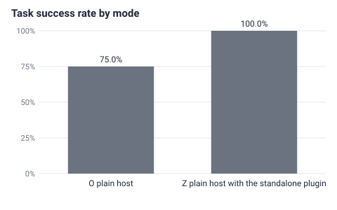
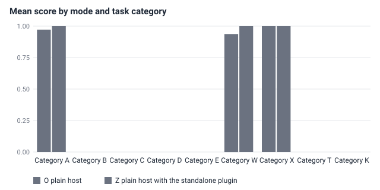
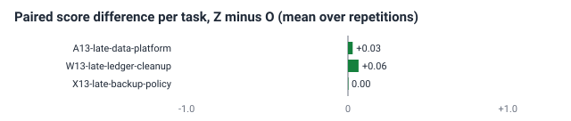
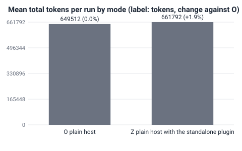

# Context Clock benchmark: v12-noharm-01

This report is generated by `benchmarks/context-clock/analysis/analyze.mjs`. The same inputs give the same bytes.

## Batch facts

| Field | Value |
|---|---|
| autoCompact | false |
| autoCompactWindow | n/a |
| batch | v12-noharm-01 |
| benchmarkCommit | 708dfe2c69c74b842d11ee8b8097b22c1bd48fb5 |
| benchmarkDirty | true |
| blocks | {"block":1,"taskId":"X13-late-backup-policy","rep":3,"modes":["Z","O"]}, {"block":2,"taskId":"X13-late-backup-policy","rep":4,"modes":["O","Z"]}, {"block":3,"taskId":"A13-late-data-platform","rep":2,"modes":["O","Z"]}, {"block":4,"taskId":"W13-late-ledger-cleanup","rep":4,"modes":["Z","O"]}, {"block":5,"taskId":"W13-late-ledger-cleanup","rep":3,"modes":["Z","O"]}, {"block":6,"taskId":"A13-late-data-platform","rep":1,"modes":["Z","O"]}, {"block":7,"taskId":"W13-late-ledger-cleanup","rep":1,"modes":["Z","O"]}, {"block":8,"taskId":"W13-late-ledger-cleanup","rep":2,"modes":["O","Z"]}, {"block":9,"taskId":"A13-late-data-platform","rep":3,"modes":["Z","O"]}, {"block":10,"taskId":"A13-late-data-platform","rep":4,"modes":["O","Z"]}, {"block":11,"taskId":"X13-late-backup-policy","rep":1,"modes":["Z","O"]}, {"block":12,"taskId":"X13-late-backup-policy","rep":2,"modes":["O","Z"]} |
| canCompact | true |
| cli.name | claude |
| cli.version | 2.1.331 |
| commitInstruction | n/a |
| compactInstruction | n/a |
| compactMechanism | /compact through claude -p --resume |
| comparisons | Z-O |
| host | claude |
| isolated | true |
| isolation.env.ENABLE_CLAUDEAI_MCP_SERVERS | false |
| isolation.settingSources | project,local |
| isolation.strictMcpConfigOverlay | false |
| isolation.strictMcpConfigPlain | true |
| limits.batch.maxConcurrency | 6 |
| limits.batch.totalTokens | 40000000 |
| limits.batch.wallTimeMs | 21600000 |
| limits.run.retries | 2 |
| limits.run.toolCalls | 120 |
| limits.run.totalTokens | 3000000 |
| limits.run.turnTimeoutMs | 420000 |
| limits.run.wallTimeMs | 1800000 |
| mock | false |
| model | haiku |
| modes | O, Z |
| node | v26.12.1 |
| order | block |
| os.arch | x64 |
| os.platform | win32 |
| os.release | 10.0.26300 |
| overlay | n/a |
| periodic | n/a |
| periodicInstruction | n/a |
| plain.plugins.O.hooks | {"event":"PreToolUse","matcher":"^(Bash\|PowerShell\|Read\|Grep\|Glob\|WebFetch\|Write\|Edit\|NotebookEdit)$","command":"node \"${CLAUDE_PLUGIN_ROOT}/ccb/guard.mjs\""} |
| plain.plugins.O.name | ccb-plain |
| plain.plugins.Z.hooks | {"event":"PreToolUse","matcher":"^(Bash\|PowerShell\|Read\|Grep\|Glob\|WebFetch\|Write\|Edit\|NotebookEdit)$","command":"node \"${CLAUDE_PLUGIN_ROOT}/ccb/guard.mjs\""} |
| plain.plugins.Z.name | ccb-plain |
| plain.plugins.Z.standalone.dir | <plugin-dir> |
| plain.plugins.Z.standalone.hooks | {"event":"PreCompact","matcher":null,"command":"node \"${CLAUDE_PLUGIN_ROOT}/scripts/precompact.mjs\""} |
| plain.plugins.Z.standalone.hooksSha256 | 1e8b74c2f99311e89f53cfc9e140ec74bbd5a40d147afa119be3e4b699c171fb |
| plain.plugins.Z.standalone.name | compaction-instruction |
| plain.plugins.Z.standalone.text.bytes | 694 |
| plain.plugins.Z.standalone.text.sha256 | 72ab92318bd8a9cfebdb422d19e46e0368c53e195bc9836ec47ace3044d92bbb |
| plain.plugins.Z.standalone.version | 0.1.0 |
| plain.settingSources | project,local |
| plain.strictMcpConfig | true |
| precompactGeneralInstruction | n/a |
| precompactPlainInstruction | n/a |
| precompactProductInstruction | n/a |
| precompactStrongInstruction | n/a |
| precompactVariantInstruction | n/a |
| promptVersion | 1 |
| remindThreshold | n/a |
| reminderInstruction | n/a |
| reps | 4 |
| runOrder | claude__X13-late-backup-policy__Z__r3, claude__X13-late-backup-policy__O__r3, claude__X13-late-backup-policy__O__r4, claude__X13-late-backup-policy__Z__r4, claude__A13-late-data-platform__O__r2, claude__A13-late-data-platform__Z__r2, claude__W13-late-ledger-cleanup__Z__r4, claude__W13-late-ledger-cleanup__O__r4, claude__W13-late-ledger-cleanup__Z__r3, claude__W13-late-ledger-cleanup__O__r3, claude__A13-late-data-platform__Z__r1, claude__A13-late-data-platform__O__r1, claude__W13-late-ledger-cleanup__Z__r1, claude__W13-late-ledger-cleanup__O__r1, claude__W13-late-ledger-cleanup__O__r2, claude__W13-late-ledger-cleanup__Z__r2, claude__A13-late-data-platform__Z__r3, claude__A13-late-data-platform__O__r3, claude__A13-late-data-platform__O__r4, claude__A13-late-data-platform__Z__r4, claude__X13-late-backup-policy__Z__r1, claude__X13-late-backup-policy__O__r1, claude__X13-late-backup-policy__O__r2, claude__X13-late-backup-policy__Z__r2 |
| schema | 1 |
| seed | 1208 |
| sessionMode | persistent |
| standingInstruction | n/a |
| stateFileInstruction | n/a |
| suite | v12-noharm |
| taskSeeds.A13-late-data-platform | 2600000 |
| taskSeeds.W13-late-ledger-cleanup | 2625000 |
| taskSeeds.X13-late-backup-policy | 2650000 |
| tasksDir | benchmarks/context-clock/tasks/v12-noharm/generated |

| Fact | Value |
|---|---|
| hosts | claude |
| modes | O, Z |
| comparisons | Z-O |
| overhead baseline | O |
| runs | 24 |
| runs with a retrieval record | 24 |
| runs with a coverage record | 24 |
| tasks | 3 |
| bootstrap | seed 20261122, 10000 iterations, resample unit task |

## Runs by status

`infra_failed`, `invalid` and `ungraded` runs are outside the accuracy numbers. `agent_failed`, `timeout` and `limit_exceeded` runs count as score 0.

| Status | O plain host | Z plain host with the standalone plugin |
|---|---|---|
| completed | 12 | 12 |
| agent_failed | 0 | 0 |
| timeout | 0 | 0 |
| limit_exceeded | 0 | 0 |
| infra_failed | 0 | 0 |
| invalid | 0 | 0 |
| ungraded | 0 | 0 |
| in accuracy numbers | 12 | 12 |

## Accuracy per mode

| Metric | O plain host | Z plain host with the standalone plugin |
|---|---|---|
| runs in accuracy | 12 | 12 |
| final accuracy (mean score) | 0.970 | 1.000 |
| task success rate | 75.0% | 100.0% |
| perfect runs | 9 | 12 |
| post-compaction continuity accuracy (final questions with preCompaction true) | n/a | n/a |
| probe (checkpoint) accuracy | n/a | n/a |
| mean continuity errors per run | 0.25 | 0.00 |
| scored 0: agent_failed | 0 | 0 |
| scored 0: timeout | 0 | 0 |
| scored 0: limit_exceeded | 0 | 0 |

## Errors per mode

Error classes come from `retrieval.json` (first match wins: run not completed, a needed event never visible, every needed event visible but one only before the last compaction, a stale value, another wrong value, no parsed answer). `agentNotedGap` is a text heuristic on the assistant messages of the stages that hold a needed event.

| Metric | O plain host | Z plain host with the standalone plugin |
|---|---|---|
| runs with a retrieval record | 12 | 12 |
| wrong final answers | 3 | 0 |
| class tool_or_infrastructure | 0 | 0 |
| class retrieval | 0 | 0 |
| class compaction_recovery | 0 | 0 |
| class state_tracking | 0 | 0 |
| class reasoning | 3 | 0 |
| class indeterminate | 0 | 0 |
| retrieval failure rate (retrieval errors / final questions) | 0.0% | 0.0% |
| retrieval share of wrong answers | 0.0% | n/a |
| wrong answers with a gap noted (heuristic) | 0 | 0 |
| cut chunks | 0 | 0 |
| cut chunks with a follow-up | 0 | 0 |
| probe class tool_or_infrastructure | 0 | 0 |
| probe class retrieval | 0 | 0 |
| probe class compaction_recovery | 0 | 0 |
| probe class state_tracking | 0 | 0 |
| probe class reasoning | 0 | 0 |
| probe class indeterminate | 0 | 0 |

## Continuity errors by category

| Error category | O plain host | Z plain host with the standalone plugin |
|---|---|---|
| forgotten_requirement | 1 | 0 |
| obsolete_decision | 2 | 0 |

## Accuracy by task category

Each cell: mean score (task success rate, number of runs).

| Category | O plain host | Z plain host with the standalone plugin |
|---|---|---|
| A | 0.972 (75%, n=4) | 1.000 (100%, n=4) |
| B | n/a | n/a |
| C | n/a | n/a |
| D | n/a | n/a |
| E | n/a | n/a |
| K | n/a | n/a |
| T | n/a | n/a |
| W | 0.938 (50%, n=4) | 1.000 (100%, n=4) |
| X | 1.000 (100%, n=4) | 1.000 (100%, n=4) |

## Accuracy per task

Each cell: mean score (task success rate, number of runs), then the post-compaction continuity accuracy.

| Task | Category | Profile | O plain host | Z plain host with the standalone plugin |
|---|---|---|---|---|
| A13-late-data-platform | A | compaction | 0.972 (75%, n=4) | 1.000 (100%, n=4) |
| W13-late-ledger-cleanup | W | compaction | 0.938 (50%, n=4) | 1.000 (100%, n=4) |
| X13-late-backup-policy | X | compaction | 1.000 (100%, n=4) | 1.000 (100%, n=4) |

## Accuracy by context size

Three groups of equal task count by `params.approxBytes`.

| Group | Bytes | Tasks |
|---|---|---|
| small | 99142 to 99142 | 1 |
| medium | 100008 to 100008 | 1 |
| large | 104979 to 104979 | 1 |

| Size | O plain host | Z plain host with the standalone plugin |
|---|---|---|
| small | 0.972 (75%, n=4) | 1.000 (100%, n=4) |
| medium | 0.938 (50%, n=4) | 1.000 (100%, n=4) |
| large | 1.000 (100%, n=4) | 1.000 (100%, n=4) |

## Accuracy by profile

| Profile | O plain host | Z plain host with the standalone plugin |
|---|---|---|
| compaction | 0.970 (75%, n=12) | 1.000 (100%, n=12) |
| long | n/a | n/a |

## Paired comparison: final score

Pairs are `(taskId, rep)`. The difference is the score of the first mode minus the score of the second mode. The interval is a percentile bootstrap that resamples tasks, so the repetitions of a task stay together. A pair with a missing or excluded run is dropped and counted.

| Comparison | Pairs | Dropped | Mean first | Mean second | Mean difference | Relative | 95% interval | Win / tie / loss |
|---|---|---|---|---|---|---|---|---|
| Z minus O (standalone plugin against the plain host, primary) | 12 | 0 | 1.000 | 0.970 | +0.030 | +3.1% | [0.000, +0.063] | 3 / 9 / 0 |

With 3 tasks the bootstrap interval over tasks is coarse. An interval that includes zero is not evidence that two arms are equal.

Completed runs only. The primary table above counts a valid run that did not complete (for example at a limit) as score 0. This table drops each pair with such a run.

| Comparison | Pairs | Dropped | Mean first | Mean second | Mean difference | Relative | 95% interval | Win / tie / loss |
|---|---|---|---|---|---|---|---|---|
| Z minus O (standalone plugin against the plain host, primary) | 12 | 0 | 1.000 | 0.970 | +0.030 | +3.1% | [0.000, +0.063] | 3 / 9 / 0 |

Difference for each pair:

| Comparison | Task | Rep | First | Second | Difference |
|---|---|---|---|---|---|
| Z-O | A13-late-data-platform | 1 | 1.000 | 0.889 | +0.111 |
| Z-O | A13-late-data-platform | 2 | 1.000 | 1.000 | 0.000 |
| Z-O | A13-late-data-platform | 3 | 1.000 | 1.000 | 0.000 |
| Z-O | A13-late-data-platform | 4 | 1.000 | 1.000 | 0.000 |
| Z-O | W13-late-ledger-cleanup | 1 | 1.000 | 0.875 | +0.125 |
| Z-O | W13-late-ledger-cleanup | 2 | 1.000 | 0.875 | +0.125 |
| Z-O | W13-late-ledger-cleanup | 3 | 1.000 | 1.000 | 0.000 |
| Z-O | W13-late-ledger-cleanup | 4 | 1.000 | 1.000 | 0.000 |
| Z-O | X13-late-backup-policy | 1 | 1.000 | 1.000 | 0.000 |
| Z-O | X13-late-backup-policy | 2 | 1.000 | 1.000 | 0.000 |
| Z-O | X13-late-backup-policy | 3 | 1.000 | 1.000 | 0.000 |
| Z-O | X13-late-backup-policy | 4 | 1.000 | 1.000 | 0.000 |

Regressions (pairs where the first mode scored lower):

No regression.

## Paired comparison: post-compaction continuity accuracy

The per-run value is the share of correct final questions with `preCompaction` true. Pairs whose runs have no such question are left out.

| Comparison | Pairs | Dropped | Mean first | Mean second | Mean difference | Relative | 95% interval | Win / tie / loss |
|---|---|---|---|---|---|---|---|---|
| Z minus O (standalone plugin against the plain host, primary) | 0 | 0 | n/a | n/a | n/a | n/a | n/a (fewer than 2 tasks) | 0 / 0 / 0 |

Regressions:

No regression.

## Paired comparison: probe (checkpoint) accuracy

The per-run value is the share of correct probe questions. A run that did not complete scores 0. Pairs whose runs have no probe question are left out. The interval uses the same task bootstrap as the final score.

| Comparison | Pairs | Dropped | Mean first | Mean second | Mean difference | Relative | 95% interval | Win / tie / loss |
|---|---|---|---|---|---|---|---|---|
| Z minus O (standalone plugin against the plain host, primary) | 0 | 0 | n/a | n/a | n/a | n/a | n/a (fewer than 2 tasks) | 0 / 0 / 0 |

Regressions:

No regression.

## Sensitivity: leave one task out

For each comparison of the final score, the mean difference with each task left out in turn. The largest change shows how much one task moves the result.

| Comparison | Mean difference | Largest change | Task | Mean without that task |
|---|---|---|---|---|
| Z-O | +0.030 | -0.016 | W13-late-ledger-cleanup | +0.014 |

| Comparison | Task left out | Mean difference without it | Change |
|---|---|---|---|
| Z-O | A13-late-data-platform | +0.031 | +0.001 |
| Z-O | W13-late-ledger-cleanup | +0.014 | -0.016 |
| Z-O | X13-late-backup-policy | +0.045 | +0.015 |

## Cost per mode

Mean per run over the runs in the accuracy numbers. A missing value in a run record is left out of its mean; a field that no run records shows n/a.

| Metric | O plain host | Z plain host with the standalone plugin |
|---|---|---|
| input tokens | 36.0 | 36.0 |
| output tokens | 15225.9 | 15468.3 |
| cache read tokens | 533618.4 | 542131.4 |
| cache creation tokens | 100631.6 | 104156.5 |
| total tokens | 649511.9 | 661792.2 |
| tool calls | 35.6 | 35.8 |
| duration (ms) | 142223.7 | 162709.0 |
| confirmed compactions | 3.0 | 3.0 |
| unconfirmed compactions | 0.0 | 0.0 |
| guard denials | 0.0 | 0.0 |
| clock feedback count | 0.0 | 0.0 |
| clock feedback bytes | 0.0 | 0.0 |
| clock commit calls | 0.0 | 0.0 |
| clock status calls | 0.0 | 0.0 |
| search calls | 0.0 | 0.0 |
| clock feedback count: tool reply | 0.0 | 0.0 |
| clock feedback bytes: tool reply | 0.0 | 0.0 |
| clock feedback count: hook context | 0.0 | 0.0 |
| clock feedback bytes: hook context | 0.0 | 0.0 |
| clock feedback count: session start | 0.0 | 0.0 |
| clock feedback bytes: session start | 0.0 | 0.0 |

## Feedback and placebo deliveries by channel

No run of this batch has shim telemetry (`telemetry.shim`).

## Run facts

| Fact | O plain host | Z plain host with the standalone plugin |
|---|---|---|
| confirmed compactions (total) | 36 | 36 |
| unconfirmed compactions (total) | 0 | 0 |
| guard denials (total) | 0 | 0 |
| limit hits | 0 | 0 |
| assistant messages that mention the clock (plain text count) | 0 | 0 |
| assistant messages that mention the placebo tag (plain text count) | 0 | 0 |

## Commit compliance per mode

From `run.json` `telemetry.commits`. Compliance is the stages with a commit divided by all stages. A batch without this field shows n/a.

| Metric | O plain host | Z plain host with the standalone plugin |
|---|---|---|
| runs with commit telemetry | 12 | 12 |
| commit calls | 0 | 0 |
| accepted commits | 0 | 0 |
| rejected commits | 0 | 0 |
| stages with a commit / stages | 0 / 96 | 0 / 96 |
| commit compliance | 0.0% | 0.0% |
| status calls in probe turns (from the stream) | 0 | 0 |
| status calls in final turns (from the stream) | 0 | 0 |

## State saves per mode

From `run.json` `telemetry.stateFile` (arm H: writes of `clock-state.md`). Compliance is the stages with a write divided by all stages. A batch without this field shows n/a.

| Metric | O plain host | Z plain host with the standalone plugin |
|---|---|---|
| runs with state file telemetry | 12 | 12 |
| state file writes | 0 | 0 |
| stages with a write / stages | 0 / 96 | 0 / 96 |
| state save compliance | 0.0% | 0.0% |

## State block facts per mode

From `run.json` `telemetry.stateBlock` (the shim log). A batch without this field shows n/a.

| Metric | O plain host | Z plain host with the standalone plugin |
|---|---|---|
| runs with state block telemetry | 0 | 0 |
| deliveries | n/a | n/a |
| missing (no committed state) | n/a | n/a |
| bytes (total) | n/a | n/a |
| bytes per delivery | n/a | n/a |
| findings (total) | n/a | n/a |
| cuts | n/a | n/a |

## Value coverage: host summary and returned block

From `coverage.json`, for each final question with a text answer. "In summary" means that every expected value is an exact substring of the last host compaction summary. "In block" is the same for the last `[committed-state]` block in the `SessionStart` hook output of that compaction turn. Each cell: accuracy (correct / questions). A real effect of the returned state shows in the cell "not in summary, in block".

| Cell | O plain host | Z plain host with the standalone plugin |
|---|---|---|
| runs with a coverage record | 12 | 12 |
| runs with a summary found | 12 | 12 |
| runs with a block found | 0 | 0 |
| text questions | 80 | 80 |
| in summary, in block | n/a | n/a |
| in summary, not in block | 96.7% (29/30) | 100.0% (32/32) |
| not in summary, in block | n/a | n/a |
| not in summary, not in block | 96.0% (48/50) | 100.0% (48/48) |

The same table for the questions that a block can answer: every expected value is in the reference state of the last compaction of the task. A value that changes after the last compaction is not in this table.

| Cell | O plain host | Z plain host with the standalone plugin |
|---|---|---|
| text questions in the reference state | 32 | 32 |
| in summary, in block | n/a | n/a |
| in summary, not in block | 96.7% (29/30) | 100.0% (32/32) |
| not in summary, in block | n/a | n/a |
| not in summary, not in block | 100.0% (2/2) | n/a |

## State correctness at each compaction

From `coverage.json` `stateCorrectness`. For compaction N, the analysis compares the returned `[committed-state]` block and the host summary of `compact-N` with the reference state after stage N. A line `name: value` counts as found when every value is an exact substring: each comma-separated element of a current value, and each element between ", then " of a history line. Lines are pooled over the compactions with a reference state. A compaction without a block counts its lines as not found. A batch without this list shows n/a.

| Metric | O plain host | Z plain host with the standalone plugin |
|---|---|---|
| compactions | 36 | 36 |
| compactions with a reference state | 36 | 36 |
| compactions with a block | 0 | 0 |
| compactions with a host summary | 36 | 36 |
| block: current-value lines found | 0.0% (0/500) | 0.0% (0/500) |
| block: current-value lines found, compactions with a block only | n/a | n/a |
| block: history lines found | 0.0% (0/292) | 0.0% (0/292) |
| summary: current-value lines found | 93.6% (468/500) | 92.4% (462/500) |
| summary: history lines found | 82.2% (240/292) | 88.4% (258/292) |

## Fact status per mode

From `facts.json`. Each row counts the reference facts of every compaction in one record: the state file copy before `/compact`, the host summary, and the returned block. `absent` means that the record does not exist. Each cell: share (count / facts). A batch without `facts.json` shows n/a.

| Record and status | O plain host | Z plain host with the standalone plugin |
|---|---|---|
| runs with facts.json | 12 | 12 |
| compactions | 36 | 36 |
| facts (compaction x fact) | 500 | 500 |
| facts with an ambiguous match | 78 | 77 |
| state file: correct | 0.0% (0/500) | 0.0% (0/500) |
| state file: formatted | 0.0% (0/500) | 0.0% (0/500) |
| state file: stale | 0.0% (0/500) | 0.0% (0/500) |
| state file: incorrect | 0.0% (0/500) | 0.0% (0/500) |
| state file: missing | 0.0% (0/500) | 0.0% (0/500) |
| state file: not assigned | 0.0% (0/500) | 0.0% (0/500) |
| state file: absent | 100.0% (500/500) | 100.0% (500/500) |
| state file: held, over all facts | 0.0% (0/500) | 0.0% (0/500) |
| state file: held, over assigned facts | 0.0% (0/500) | 0.0% (0/500) |
| summary: correct | 40.4% (202/500) | 33.8% (169/500) |
| summary: formatted | 0.0% (0/500) | 0.0% (0/500) |
| summary: stale | 0.4% (2/500) | 0.4% (2/500) |
| summary: incorrect | 0.0% (0/500) | 0.0% (0/500) |
| summary: missing | 53.2% (266/500) | 51.4% (257/500) |
| summary: not assigned | 6.0% (30/500) | 14.4% (72/500) |
| summary: absent | 0.0% (0/500) | 0.0% (0/500) |
| summary: held, over all facts | 40.4% (202/500) | 33.8% (169/500) |
| summary: held, over assigned facts | 43.0% (202/470) | 39.5% (169/428) |
| block: correct | 0.0% (0/500) | 0.0% (0/500) |
| block: formatted | 0.0% (0/500) | 0.0% (0/500) |
| block: stale | 0.0% (0/500) | 0.0% (0/500) |
| block: incorrect | 0.0% (0/500) | 0.0% (0/500) |
| block: missing | 0.0% (0/500) | 0.0% (0/500) |
| block: not assigned | 0.0% (0/500) | 0.0% (0/500) |
| block: absent | 100.0% (500/500) | 100.0% (500/500) |
| block: held, over all facts | 0.0% (0/500) | 0.0% (0/500) |
| block: held, over assigned facts | 0.0% (0/500) | 0.0% (0/500) |

`not assigned`: the matcher found a line or a phrase for the fact, but its name ties with another fact and nothing else gives a reading. It does not count as missing. Held: correct or formatted. The two held rows give the share over all facts and over the facts that the matcher assigned (all facts minus `not assigned`).

History status: the same rules against the reference history, for the facts that have earlier values.

| Record and status | O plain host | Z plain host with the standalone plugin |
|---|---|---|
| state file history: correct | 0.0% (0/292) | 0.0% (0/292) |
| state file history: formatted | 0.0% (0/292) | 0.0% (0/292) |
| state file history: stale | 0.0% (0/292) | 0.0% (0/292) |
| state file history: incorrect | 0.0% (0/292) | 0.0% (0/292) |
| state file history: missing | 0.0% (0/292) | 0.0% (0/292) |
| state file history: not assigned | 0.0% (0/292) | 0.0% (0/292) |
| state file history: absent | 100.0% (292/292) | 100.0% (292/292) |
| state file history: held, over all facts | 0.0% (0/292) | 0.0% (0/292) |
| state file history: held, over assigned facts | 0.0% (0/292) | 0.0% (0/292) |
| summary history: correct | 22.9% (67/292) | 11.3% (33/292) |
| summary history: formatted | 0.0% (0/292) | 0.0% (0/292) |
| summary history: stale | 2.7% (8/292) | 2.1% (6/292) |
| summary history: incorrect | 4.8% (14/292) | 3.4% (10/292) |
| summary history: missing | 63.7% (186/292) | 70.9% (207/292) |
| summary history: not assigned | 5.8% (17/292) | 12.3% (36/292) |
| summary history: absent | 0.0% (0/292) | 0.0% (0/292) |
| summary history: held, over all facts | 22.9% (67/292) | 11.3% (33/292) |
| summary history: held, over assigned facts | 24.4% (67/275) | 12.9% (33/256) |
| block history: correct | 0.0% (0/292) | 0.0% (0/292) |
| block history: formatted | 0.0% (0/292) | 0.0% (0/292) |
| block history: stale | 0.0% (0/292) | 0.0% (0/292) |
| block history: incorrect | 0.0% (0/292) | 0.0% (0/292) |
| block history: missing | 0.0% (0/292) | 0.0% (0/292) |
| block history: not assigned | 0.0% (0/292) | 0.0% (0/292) |
| block history: absent | 100.0% (292/292) | 100.0% (292/292) |
| block history: held, over all facts | 0.0% (0/292) | 0.0% (0/292) |
| block history: held, over assigned facts | 0.0% (0/292) | 0.0% (0/292) |

## Question join

For each final and probe question whose key names a fact: the status of that fact (current or history part) in the last state file, summary and block before the question. Key: state file status | summary status | block present. Each cell: answer accuracy (correct / questions).

| State file | summary | block | O plain host | Z plain host with the standalone plugin |
|---|---|---|
| absent \| missing \| no block | 100.0% (4/4) | 100.0% (4/4) |

## Anchoring candidates

A candidate: the answer is wrong, the returned block or the state file is `stale` or `incorrect` for its fact, and the summary is `correct` or `formatted`. The lead reads each candidate in the trace. A trace shows what the agent wrote and did, not the internal reasoning of the model.

No anchoring candidate.

## Ambiguous matches

Facts whose name matched only by substring, or whose summary unit holds the current value and an earlier value so that the rule cannot order them. The lead reads these cases.

| Run | Mode | Stage | Fact | Reason |
|---|---|---|---|---|
| claude__A13-late-data-platform__O__r1 | O | 3 | transform tool | summary: current and earlier value in the same unit |
| claude__A13-late-data-platform__O__r1 | O | 3 | ingestion tool | summary: current and earlier value in the same unit |
| claude__A13-late-data-platform__O__r1 | O | 3 | dashboard tool | summary: current and earlier value in the same unit |
| claude__A13-late-data-platform__O__r1 | O | 3 | stream processor | summary: current and earlier value in the same unit |
| claude__A13-late-data-platform__O__r1 | O | 3 | cost alert flag | summary: current and earlier value in the same unit |
| claude__A13-late-data-platform__O__r2 | O | 3 | transform tool | summary: current and earlier value in the same unit |
| claude__A13-late-data-platform__O__r2 | O | 3 | ingestion tool | summary: current and earlier value in the same unit |
| claude__A13-late-data-platform__O__r2 | O | 3 | dashboard tool | summary: current and earlier value in the same unit |
| claude__A13-late-data-platform__O__r2 | O | 3 | stream processor | summary: current and earlier value in the same unit |
| claude__A13-late-data-platform__O__r2 | O | 3 | raw data retention in days | summary: current and earlier value in the same unit |
| claude__A13-late-data-platform__O__r2 | O | 3 | cost alert flag | summary: current and earlier value in the same unit |
| claude__A13-late-data-platform__O__r2 | O | 5 | job orchestrator | summary: current and earlier value in the same unit |
| claude__A13-late-data-platform__O__r2 | O | 5 | transform tool | summary: current and earlier value in the same unit |
| claude__A13-late-data-platform__O__r2 | O | 5 | ingestion tool | summary: current and earlier value in the same unit |
| claude__A13-late-data-platform__O__r2 | O | 5 | data catalog | summary: current and earlier value in the same unit |
| claude__A13-late-data-platform__O__r2 | O | 5 | dashboard tool | summary: current and earlier value in the same unit |
| claude__A13-late-data-platform__O__r2 | O | 5 | stream processor | summary: current and earlier value in the same unit |
| claude__A13-late-data-platform__O__r2 | O | 5 | cost alert flag | summary: current and earlier value in the same unit |
| claude__A13-late-data-platform__O__r3 | O | 3 | transform tool | summary: current and earlier value in the same unit |
| claude__A13-late-data-platform__O__r3 | O | 3 | ingestion tool | summary: current and earlier value in the same unit |
| claude__A13-late-data-platform__O__r3 | O | 3 | dashboard tool | summary: current and earlier value in the same unit |
| claude__A13-late-data-platform__O__r3 | O | 3 | stream processor | summary: current and earlier value in the same unit |
| claude__A13-late-data-platform__O__r3 | O | 3 | raw data retention in days | summary: current and earlier value in the same unit |
| claude__A13-late-data-platform__O__r3 | O | 3 | cost alert flag | summary: current and earlier value in the same unit |
| claude__A13-late-data-platform__O__r3 | O | 5 | transform tool | summary: current and earlier value in the same unit |
| claude__A13-late-data-platform__O__r3 | O | 5 | ingestion tool | summary: current and earlier value in the same unit |
| claude__A13-late-data-platform__O__r3 | O | 5 | cost alert flag | summary: current and earlier value in the same unit |
| claude__A13-late-data-platform__Z__r1 | Z | 3 | data catalog | summary: current and earlier value in the same unit |
| claude__W13-late-ledger-cleanup__O__r2 | O | 5 | work item that blocks LDG-275 | summary: a name ties with another fact |
| claude__W13-late-ledger-cleanup__O__r2 | O | 5 | work item that blocks LDG-258 | summary: a name ties with another fact |
| claude__W13-late-ledger-cleanup__O__r2 | O | 5 | work item that blocks LDG-227 | summary: a name ties with another fact |
| claude__W13-late-ledger-cleanup__O__r2 | O | 5 | work item that blocks LDG-231 | summary: a name ties with another fact |
| claude__W13-late-ledger-cleanup__O__r2 | O | 5 | work item that blocks LDG-289 | summary: a name ties with another fact |
| claude__W13-late-ledger-cleanup__O__r2 | O | 5 | work item that blocks LDG-214 | summary: a name ties with another fact |
| claude__W13-late-ledger-cleanup__O__r2 | O | 5 | status of the file src/ledger/accounts.ts | summary: current and earlier value in the same unit |
| claude__W13-late-ledger-cleanup__O__r2 | O | 7 | work item that blocks LDG-275 | summary: a name ties with another fact |
| claude__W13-late-ledger-cleanup__O__r2 | O | 7 | work item that blocks LDG-258 | summary: a name ties with another fact |
| claude__W13-late-ledger-cleanup__O__r2 | O | 7 | work item that blocks LDG-227 | summary: a name ties with another fact |
| claude__W13-late-ledger-cleanup__O__r2 | O | 7 | work item that blocks LDG-231 | summary: a name ties with another fact |
| claude__W13-late-ledger-cleanup__O__r2 | O | 7 | work item that blocks LDG-289 | summary: a name ties with another fact |
| claude__W13-late-ledger-cleanup__O__r2 | O | 7 | work item that blocks LDG-214 | summary: a name ties with another fact |
| claude__W13-late-ledger-cleanup__O__r2 | O | 7 | status of the file src/ledger/accounts.ts | summary: current and earlier value in the same unit |
| claude__W13-late-ledger-cleanup__O__r3 | O | 5 | work item that blocks LDG-275 | summary: a name ties with another fact |
| claude__W13-late-ledger-cleanup__O__r3 | O | 5 | work item that blocks LDG-258 | summary: a name ties with another fact |
| claude__W13-late-ledger-cleanup__O__r3 | O | 5 | work item that blocks LDG-227 | summary: a name ties with another fact |
| claude__W13-late-ledger-cleanup__O__r3 | O | 5 | work item that blocks LDG-231 | summary: a name ties with another fact |
| claude__W13-late-ledger-cleanup__O__r3 | O | 5 | work item that blocks LDG-289 | summary: a name ties with another fact |
| claude__W13-late-ledger-cleanup__O__r3 | O | 5 | work item that blocks LDG-214 | summary: a name ties with another fact |
| claude__W13-late-ledger-cleanup__O__r4 | O | 3 | work item that blocks LDG-275 | summary: a name ties with another fact |
| claude__W13-late-ledger-cleanup__O__r4 | O | 3 | work item that blocks LDG-258 | summary: a name ties with another fact |
| claude__W13-late-ledger-cleanup__O__r4 | O | 3 | work item that blocks LDG-227 | summary: a name ties with another fact |
| claude__W13-late-ledger-cleanup__O__r4 | O | 3 | work item that blocks LDG-231 | summary: a name ties with another fact |
| claude__W13-late-ledger-cleanup__O__r4 | O | 3 | work item that blocks LDG-289 | summary: a name ties with another fact; summary: current and earlier value in the same unit |
| claude__W13-late-ledger-cleanup__O__r4 | O | 3 | work item that blocks LDG-214 | summary: a name ties with another fact; summary: current and earlier value in the same unit |
| claude__W13-late-ledger-cleanup__O__r4 | O | 5 | work item that blocks LDG-275 | summary: a name ties with another fact |
| claude__W13-late-ledger-cleanup__O__r4 | O | 5 | work item that blocks LDG-258 | summary: a name ties with another fact |
| claude__W13-late-ledger-cleanup__O__r4 | O | 5 | work item that blocks LDG-227 | summary: a name ties with another fact |
| claude__W13-late-ledger-cleanup__O__r4 | O | 5 | work item that blocks LDG-231 | summary: a name ties with another fact |
| claude__W13-late-ledger-cleanup__O__r4 | O | 5 | work item that blocks LDG-289 | summary: a name ties with another fact |
| claude__W13-late-ledger-cleanup__O__r4 | O | 5 | work item that blocks LDG-214 | summary: a name ties with another fact |
| claude__W13-late-ledger-cleanup__O__r4 | O | 7 | work item that blocks LDG-275 | summary: a name ties with another fact |
| claude__W13-late-ledger-cleanup__O__r4 | O | 7 | work item that blocks LDG-258 | summary: a name ties with another fact |
| claude__W13-late-ledger-cleanup__O__r4 | O | 7 | work item that blocks LDG-227 | summary: a name ties with another fact |
| claude__W13-late-ledger-cleanup__O__r4 | O | 7 | work item that blocks LDG-231 | summary: a name ties with another fact |
| claude__W13-late-ledger-cleanup__O__r4 | O | 7 | work item that blocks LDG-289 | summary: a name ties with another fact |
| claude__W13-late-ledger-cleanup__O__r4 | O | 7 | work item that blocks LDG-214 | summary: a name ties with another fact |
| claude__W13-late-ledger-cleanup__Z__r1 | Z | 3 | work item that blocks LDG-275 | summary: a name ties with another fact |
| claude__W13-late-ledger-cleanup__Z__r1 | Z | 3 | work item that blocks LDG-258 | summary: a name ties with another fact |
| claude__W13-late-ledger-cleanup__Z__r1 | Z | 3 | work item that blocks LDG-227 | summary: a name ties with another fact |
| claude__W13-late-ledger-cleanup__Z__r1 | Z | 3 | work item that blocks LDG-231 | summary: a name ties with another fact |
| claude__W13-late-ledger-cleanup__Z__r1 | Z | 3 | work item that blocks LDG-289 | summary: a name ties with another fact |
| claude__W13-late-ledger-cleanup__Z__r1 | Z | 3 | work item that blocks LDG-214 | summary: a name ties with another fact |
| claude__W13-late-ledger-cleanup__Z__r1 | Z | 5 | work item that blocks LDG-275 | summary: a name ties with another fact |
| claude__W13-late-ledger-cleanup__Z__r1 | Z | 5 | work item that blocks LDG-258 | summary: a name ties with another fact |
| claude__W13-late-ledger-cleanup__Z__r1 | Z | 5 | work item that blocks LDG-227 | summary: a name ties with another fact |
| claude__W13-late-ledger-cleanup__Z__r1 | Z | 5 | work item that blocks LDG-231 | summary: a name ties with another fact |
| claude__W13-late-ledger-cleanup__Z__r1 | Z | 5 | work item that blocks LDG-289 | summary: a name ties with another fact |
| claude__W13-late-ledger-cleanup__Z__r1 | Z | 5 | work item that blocks LDG-214 | summary: a name ties with another fact |
| claude__W13-late-ledger-cleanup__Z__r1 | Z | 7 | work item that blocks LDG-275 | summary: a name ties with another fact |
| claude__W13-late-ledger-cleanup__Z__r1 | Z | 7 | work item that blocks LDG-258 | summary: a name ties with another fact |
| claude__W13-late-ledger-cleanup__Z__r1 | Z | 7 | work item that blocks LDG-227 | summary: a name ties with another fact |
| claude__W13-late-ledger-cleanup__Z__r1 | Z | 7 | work item that blocks LDG-231 | summary: a name ties with another fact |
| claude__W13-late-ledger-cleanup__Z__r1 | Z | 7 | work item that blocks LDG-289 | summary: a name ties with another fact |
| claude__W13-late-ledger-cleanup__Z__r1 | Z | 7 | work item that blocks LDG-214 | summary: a name ties with another fact |
| claude__W13-late-ledger-cleanup__Z__r2 | Z | 3 | work item that blocks LDG-275 | summary: a name ties with another fact |
| claude__W13-late-ledger-cleanup__Z__r2 | Z | 3 | work item that blocks LDG-258 | summary: a name ties with another fact |
| claude__W13-late-ledger-cleanup__Z__r2 | Z | 3 | work item that blocks LDG-227 | summary: a name ties with another fact |
| claude__W13-late-ledger-cleanup__Z__r2 | Z | 3 | work item that blocks LDG-231 | summary: a name ties with another fact |
| claude__W13-late-ledger-cleanup__Z__r2 | Z | 3 | work item that blocks LDG-289 | summary: a name ties with another fact |
| claude__W13-late-ledger-cleanup__Z__r2 | Z | 3 | work item that blocks LDG-214 | summary: a name ties with another fact |
| claude__W13-late-ledger-cleanup__Z__r2 | Z | 5 | work item that blocks LDG-275 | summary: a name ties with another fact |
| claude__W13-late-ledger-cleanup__Z__r2 | Z | 5 | work item that blocks LDG-258 | summary: a name ties with another fact |
| claude__W13-late-ledger-cleanup__Z__r2 | Z | 5 | work item that blocks LDG-227 | summary: a name ties with another fact |
| claude__W13-late-ledger-cleanup__Z__r2 | Z | 5 | work item that blocks LDG-231 | summary: a name ties with another fact |
| claude__W13-late-ledger-cleanup__Z__r2 | Z | 5 | work item that blocks LDG-289 | summary: a name ties with another fact |
| claude__W13-late-ledger-cleanup__Z__r2 | Z | 5 | work item that blocks LDG-214 | summary: a name ties with another fact |
| claude__W13-late-ledger-cleanup__Z__r2 | Z | 7 | work item that blocks LDG-275 | summary: a name ties with another fact |
| claude__W13-late-ledger-cleanup__Z__r2 | Z | 7 | work item that blocks LDG-258 | summary: a name ties with another fact |
| claude__W13-late-ledger-cleanup__Z__r2 | Z | 7 | work item that blocks LDG-227 | summary: a name ties with another fact |
| claude__W13-late-ledger-cleanup__Z__r2 | Z | 7 | work item that blocks LDG-231 | summary: a name ties with another fact |
| claude__W13-late-ledger-cleanup__Z__r2 | Z | 7 | work item that blocks LDG-289 | summary: a name ties with another fact |
| claude__W13-late-ledger-cleanup__Z__r2 | Z | 7 | work item that blocks LDG-214 | summary: a name ties with another fact |
| claude__W13-late-ledger-cleanup__Z__r3 | Z | 3 | work item that blocks LDG-275 | summary: a name ties with another fact |
| claude__W13-late-ledger-cleanup__Z__r3 | Z | 3 | work item that blocks LDG-258 | summary: a name ties with another fact |
| claude__W13-late-ledger-cleanup__Z__r3 | Z | 3 | work item that blocks LDG-227 | summary: a name ties with another fact |
| claude__W13-late-ledger-cleanup__Z__r3 | Z | 3 | work item that blocks LDG-231 | summary: a name ties with another fact |
| claude__W13-late-ledger-cleanup__Z__r3 | Z | 3 | work item that blocks LDG-289 | summary: a name ties with another fact |
| claude__W13-late-ledger-cleanup__Z__r3 | Z | 3 | work item that blocks LDG-214 | summary: a name ties with another fact |
| claude__W13-late-ledger-cleanup__Z__r3 | Z | 5 | work item that blocks LDG-275 | summary: a name ties with another fact |
| claude__W13-late-ledger-cleanup__Z__r3 | Z | 5 | work item that blocks LDG-258 | summary: a name ties with another fact |
| claude__W13-late-ledger-cleanup__Z__r3 | Z | 5 | work item that blocks LDG-227 | summary: a name ties with another fact |
| claude__W13-late-ledger-cleanup__Z__r3 | Z | 5 | work item that blocks LDG-231 | summary: a name ties with another fact |
| claude__W13-late-ledger-cleanup__Z__r3 | Z | 5 | work item that blocks LDG-289 | summary: a name ties with another fact |
| claude__W13-late-ledger-cleanup__Z__r3 | Z | 5 | work item that blocks LDG-214 | summary: a name ties with another fact |
| claude__W13-late-ledger-cleanup__Z__r3 | Z | 7 | work item that blocks LDG-275 | summary: a name ties with another fact |
| claude__W13-late-ledger-cleanup__Z__r3 | Z | 7 | work item that blocks LDG-258 | summary: a name ties with another fact |
| claude__W13-late-ledger-cleanup__Z__r3 | Z | 7 | work item that blocks LDG-227 | summary: a name ties with another fact |
| claude__W13-late-ledger-cleanup__Z__r3 | Z | 7 | work item that blocks LDG-231 | summary: a name ties with another fact |
| claude__W13-late-ledger-cleanup__Z__r3 | Z | 7 | work item that blocks LDG-289 | summary: a name ties with another fact |
| claude__W13-late-ledger-cleanup__Z__r3 | Z | 7 | work item that blocks LDG-214 | summary: a name ties with another fact |
| claude__W13-late-ledger-cleanup__Z__r4 | Z | 3 | work item that blocks LDG-275 | summary: a name ties with another fact |
| claude__W13-late-ledger-cleanup__Z__r4 | Z | 3 | work item that blocks LDG-258 | summary: a name ties with another fact |
| claude__W13-late-ledger-cleanup__Z__r4 | Z | 3 | work item that blocks LDG-227 | summary: a name ties with another fact |
| claude__W13-late-ledger-cleanup__Z__r4 | Z | 3 | work item that blocks LDG-231 | summary: a name ties with another fact |
| claude__W13-late-ledger-cleanup__Z__r4 | Z | 3 | work item that blocks LDG-289 | summary: a name ties with another fact |
| claude__W13-late-ledger-cleanup__Z__r4 | Z | 3 | work item that blocks LDG-214 | summary: a name ties with another fact |
| claude__W13-late-ledger-cleanup__Z__r4 | Z | 5 | work item that blocks LDG-275 | summary: a name ties with another fact |
| claude__W13-late-ledger-cleanup__Z__r4 | Z | 5 | work item that blocks LDG-258 | summary: a name ties with another fact |
| claude__W13-late-ledger-cleanup__Z__r4 | Z | 5 | work item that blocks LDG-227 | summary: a name ties with another fact |
| claude__W13-late-ledger-cleanup__Z__r4 | Z | 5 | work item that blocks LDG-231 | summary: a name ties with another fact |
| claude__W13-late-ledger-cleanup__Z__r4 | Z | 5 | work item that blocks LDG-289 | summary: a name ties with another fact |
| claude__W13-late-ledger-cleanup__Z__r4 | Z | 5 | work item that blocks LDG-214 | summary: a name ties with another fact |
| claude__W13-late-ledger-cleanup__Z__r4 | Z | 7 | work item that blocks LDG-275 | summary: a name ties with another fact |
| claude__W13-late-ledger-cleanup__Z__r4 | Z | 7 | work item that blocks LDG-258 | summary: a name ties with another fact |
| claude__W13-late-ledger-cleanup__Z__r4 | Z | 7 | work item that blocks LDG-227 | summary: a name ties with another fact |
| claude__W13-late-ledger-cleanup__Z__r4 | Z | 7 | work item that blocks LDG-231 | summary: a name ties with another fact |
| claude__W13-late-ledger-cleanup__Z__r4 | Z | 7 | work item that blocks LDG-289 | summary: a name ties with another fact |
| claude__W13-late-ledger-cleanup__Z__r4 | Z | 7 | work item that blocks LDG-214 | summary: a name ties with another fact |
| claude__X13-late-backup-policy__O__r1 | O | 5 | decision on the export format | summary: a name ties with another fact |
| claude__X13-late-backup-policy__O__r1 | O | 5 | decision on the data catalog | summary: a name ties with another fact |
| claude__X13-late-backup-policy__O__r1 | O | 5 | decision on the pseudonym hash | summary: a name ties with another fact |
| claude__X13-late-backup-policy__O__r1 | O | 5 | status of the constraint cn-budget-cap | summary: current and earlier value in the same unit |
| claude__X13-late-backup-policy__O__r1 | O | 7 | decision on the export format | summary: a name ties with another fact |
| claude__X13-late-backup-policy__O__r1 | O | 7 | decision on the data catalog | summary: a name ties with another fact |
| claude__X13-late-backup-policy__O__r1 | O | 7 | decision on the pseudonym hash | summary: a name ties with another fact |
| claude__X13-late-backup-policy__O__r1 | O | 7 | status of the constraint cn-budget-cap | summary: current and earlier value in the same unit |
| claude__X13-late-backup-policy__O__r2 | O | 5 | status of the constraint cn-no-weekend-jobs | summary: current and earlier value in the same unit |
| claude__X13-late-backup-policy__O__r2 | O | 5 | status of the constraint cn-keep-backups | summary: current and earlier value in the same unit |
| claude__X13-late-backup-policy__O__r2 | O | 7 | status of the constraint cn-no-weekend-jobs | summary: current and earlier value in the same unit |
| claude__X13-late-backup-policy__O__r2 | O | 7 | status of the constraint cn-keep-backups | summary: current and earlier value in the same unit |
| claude__X13-late-backup-policy__O__r4 | O | 3 | answer to the open question oq-restore-sla | summary: current and earlier value in the same unit |
| claude__X13-late-backup-policy__Z__r3 | Z | 3 | answer to the open question oq-test-data | summary: current and earlier value in the same unit |
| claude__X13-late-backup-policy__Z__r3 | Z | 3 | answer to the open question oq-restore-sla | summary: current and earlier value in the same unit |
| claude__X13-late-backup-policy__Z__r3 | Z | 5 | answer to the open question oq-test-data | summary: current and earlier value in the same unit |
| claude__X13-late-backup-policy__Z__r3 | Z | 7 | answer to the open question oq-test-data | summary: current and earlier value in the same unit |

## State file writes, reads and size

Writes and reads from `run.json` `telemetry.stateFile`. Stream reads: each Read, Grep or Bash call that names `clock-state.md`, from the raw streams (`facts.json`). Size: the copies `state-file-<N>.md` before each compaction.

| Metric | O plain host | Z plain host with the standalone plugin |
|---|---|---|
| writes (telemetry) | 0 | 0 |
| reads (telemetry) | 0 | 0 |
| reads after a compaction (telemetry) | 0 | 0 |
| reads (stream) | 0 | 0 |
| reads after a compaction (stream) | 0 | 0 |
| runs with a read after a compaction (stream) | 0 | 0 |
| state file copies | 0 | 0 |
| bytes per copy (mean) | n/a | n/a |
| bytes of the largest copy | n/a | n/a |

## Tokens by kind

Sums of the usage of each turn in `run.json`, mean per run. `costUsd` is the sum of the turn costs where the stream gives them.

| Kind | O plain host | Z plain host with the standalone plugin |
|---|---|---|
| runs with turn usage | 12 | 12 |
| input | 36 | 36 |
| cached input (cache read) | 533618 | 542131 |
| cache creation | 100632 | 104157 |
| output | 15226 | 15468 |
| total | 649512 | 661792 |
| cost in USD per run | 0.0437 | 0.0473 |

Added tokens against O (mean per run):

| Kind | Z minus O | Z against O (%) |
|---|---|---|
| input | 0 | 0.0% |
| cached input (cache read) | +8513 | +1.6% |
| cache creation | +3525 | +3.5% |
| output | +242 | +1.6% |
| total | +12280 | +1.9% |

## Compactions: stage and context size

`preTokens` is the context size before the compaction, from `run.json` or from the `compact_metadata` of the host stream.

| After stage | O compactions | Z compactions | O mean preTokens | Z mean preTokens |
|---|---|---|---|---|
| 3 | 12 | 12 | 47394 | 47269 |
| 5 | 12 | 12 | 39901 | 41169 |
| 7 | 12 | 12 | 41042 | 41833 |

In each task and repetition block, every mode compacted after the same stages.

## State file freshness at each compaction

From `facts.json` and `run.json` `telemetry.stateFile.writeStages`. Stages since the last write: the compaction stage minus the last stage with a write of `clock-state.md` at or before it. A fact is held when its state file status is `correct` or `formatted`. Only runs with `writeStages` count in the split. A batch without the field shows n/a.

| Metric | O plain host | Z plain host with the standalone plugin |
|---|---|---|
| compactions with a state file | 0.0% (0/36) | 0.0% (0/36) |
| runs with writeStages | 12 | 12 |
| writes per stage | 0.00 | 0.00 |
| compactions: 0 stages since the last write | 0.0% (0/36) | 0.0% (0/36) |
| compactions: 1 stage since the last write | 0.0% (0/36) | 0.0% (0/36) |
| compactions: 2 or more stages since the last write | 0.0% (0/36) | 0.0% (0/36) |
| compactions: no write before the compaction | 100.0% (36/36) | 100.0% (36/36) |
| facts held: 0 stages since the last write | n/a | n/a |
| facts held: 1 stage since the last write | n/a | n/a |
| facts held: 2 or more stages since the last write | n/a | n/a |
| facts held: no write before the compaction | 0.0% (0/500) | 0.0% (0/500) |

Write stages of each run:

| Run | Mode | Last write stage | Write stages |
|---|---|---|---|
| claude__A13-late-data-platform__O__r1 | O | n/a | none |
| claude__A13-late-data-platform__O__r2 | O | n/a | none |
| claude__A13-late-data-platform__O__r3 | O | n/a | none |
| claude__A13-late-data-platform__O__r4 | O | n/a | none |
| claude__W13-late-ledger-cleanup__O__r1 | O | n/a | none |
| claude__W13-late-ledger-cleanup__O__r2 | O | n/a | none |
| claude__W13-late-ledger-cleanup__O__r3 | O | n/a | none |
| claude__W13-late-ledger-cleanup__O__r4 | O | n/a | none |
| claude__X13-late-backup-policy__O__r1 | O | n/a | none |
| claude__X13-late-backup-policy__O__r2 | O | n/a | none |
| claude__X13-late-backup-policy__O__r3 | O | n/a | none |
| claude__X13-late-backup-policy__O__r4 | O | n/a | none |
| claude__A13-late-data-platform__Z__r1 | Z | n/a | none |
| claude__A13-late-data-platform__Z__r2 | Z | n/a | none |
| claude__A13-late-data-platform__Z__r3 | Z | n/a | none |
| claude__A13-late-data-platform__Z__r4 | Z | n/a | none |
| claude__W13-late-ledger-cleanup__Z__r1 | Z | n/a | none |
| claude__W13-late-ledger-cleanup__Z__r2 | Z | n/a | none |
| claude__W13-late-ledger-cleanup__Z__r3 | Z | n/a | none |
| claude__W13-late-ledger-cleanup__Z__r4 | Z | n/a | none |
| claude__X13-late-backup-policy__Z__r1 | Z | n/a | none |
| claude__X13-late-backup-policy__Z__r2 | Z | n/a | none |
| claude__X13-late-backup-policy__Z__r3 | Z | n/a | none |
| claude__X13-late-backup-policy__Z__r4 | Z | n/a | none |

## Trigger records

From `run.json` `telemetry.triggers`. Standing: deliveries of the `SessionStart` instruction. Reminder: each `PostToolUse` reminder with its context estimate, and the true `preTokens` of the next compaction. PreCompact: deliveries of the summarizer instruction, and the `hook_response` lines with `hook_event` PreCompact in the raw compact streams. A batch without the field shows n/a.

| Metric | O plain host | Z plain host with the standalone plugin |
|---|---|---|
| standing: runs | 12 | 12 |
| standing: deliveries per run (mean) | 0.00 | 0.00 |
| reminder: runs | 12 | 12 |
| reminder: fired | 0 | 0 |
| reminder: compactions with no reminder before them | 36 | 36 |
| reminder: compactions with one reminder before them | 0 | 0 |
| reminder: compactions with more than one reminder before them | 0 | 0 |
| reminder: fired after the last compaction | 0 | 0 |
| reminder: unreadable transcripts | 0 | 0 |
| reminder: estimate minus preTokens (mean) | n/a | n/a |
| reminder: absolute difference (mean) | n/a | n/a |
| precompact: deliveries | 0 | 0 |
| precompact: deliveries per compaction | 0.00 | 0.00 |
| stream: compactions with a PreCompact hook line | 0/36 | 0/36 |
| stream: PreCompact responses (success) | 0 (0) | 0 (0) |
| stream: PreCompact output bytes (mean) | n/a | n/a |

## Early wrong readings

A wrong final answer of a completed run whose fact was already `stale` or `incorrect` in the state file or in the host summary at the first compaction, or, for a fact that changed later, at the first compaction at or after the stage that last changed it. Anchoring candidates are listed above. A `facts.json` without the field shows n/a.

| Metric | O plain host | Z plain host with the standalone plugin |
|---|---|---|
| wrong final answers (retrieval) | 3 | 0 |
| wrong final answers with a fact | 0 | 0 |
| early wrong readings | 0 | 0 |
| wrong answers with a status at that compaction | 0 | 0 |
| anchoring candidates among the wrong final answers | 0 | 0 |

## Runs with denied attempts

Validity rule of v0.8: a run whose integrity violations were all denied by the guard stays valid (graders/grade.mjs deniedViolations). A violation counts as denied when the raw stream of its turn holds at least one call of the same tool whose input matches the violation excerpt, and every such call got the guard error result. The guard log must also hold at least as many denials as denied calls. A run with one violation that was not denied is invalid. These runs stay in the primary tables.

Repair of v0.9: an excerpt that is a part of a regular expression literal (an escape letter with the closing slash and flags, or a counted quantifier) is not a path and needs no denial. A run of slashes in the call input counts as one slash, so that a path in a string literal of code matches its excerpt.

| Metric | O plain host | Z plain host with the standalone plugin |
|---|---|---|
| runs valid with denied attempts | 0 | 1 |

| Run | Mode | Violations | Denied calls | Guard denials |
|---|---|---|---|---|
| claude__W13-late-ledger-cleanup__Z__r3 | Z | 14 | 0 | 0 |

## Accuracy and paired comparison under the old rule

The old rule: a run with any integrity violation is invalid and outside the accuracy numbers. This table is for comparison only.

| Metric | O plain host | Z plain host with the standalone plugin |
|---|---|---|
| runs in accuracy | 12 | 11 |
| invalid runs | 0 | 1 |
| final accuracy (mean score) | 0.970 | 1.000 |
| task success rate | 75.0% | 100.0% |

| Comparison | Pairs | Dropped | Mean first | Mean second | Mean difference | Relative | 95% interval | Win / tie / loss |
|---|---|---|---|---|---|---|---|---|
| Z minus O (standalone plugin against the plain host, primary) | 11 | 1 | 1.000 | 0.967 | +0.033 | +3.4% | [0.000, +0.083] | 3 / 8 / 0 |

## Cost per added call

Means per run over the runs in the accuracy numbers. Tool calls and tokens come from `run.json` `telemetry`. Added values are against B. Added tokens for each added call: added tokens divided by added tool calls, n/a when the mode adds no call. Saves: `telemetry.stateFile.writeStages` (else `writes`). Cost in dollars: `telemetry.costUsd` as the host reports it, n/a when null.

| Metric | O plain host | Z plain host with the standalone plugin |
|---|---|---|
| tool calls per run | 35.58 | 35.83 |
| added tool calls per run | n/a | n/a |
| tokens per run | 649512 | 661792 |
| added tokens per run | n/a | n/a |
| added tokens per added call | n/a | n/a |
| saves per run | 0.00 | 0.00 |
| cost in USD per run | 0.0437 | 0.0473 |
| cost in USD, all runs | 0.5247 | 0.5682 |

## Periodic reminder

From `run.json` `telemetry.triggers.periodic`: each user message that held the reminder (its number `n` and its turn, with the stage of that turn), and the stage of each save (`telemetry.stateFile.writeStages`). The freshness rows repeat the section above: the stages between the last save and each compaction.

| Metric | O plain host | Z plain host with the standalone plugin |
|---|---|---|
| runs with periodic reminders | 12 | 12 |
| reminders | 0 | 0 |
| reminders per run | 0.00 | 0.00 |
| user messages per run | 0.00 | 0.00 |
| compactions: 0 stages since the last write | 0.0% (0/36) | 0.0% (0/36) |
| compactions: 1 stage since the last write | 0.0% (0/36) | 0.0% (0/36) |
| compactions: 2 or more stages since the last write | 0.0% (0/36) | 0.0% (0/36) |
| compactions: no write before the compaction | 100.0% (36/36) | 100.0% (36/36) |

| Run | Mode | User messages | Reminders (n, turn, stage) | Save stages |
|---|---|---|---|---|
| claude__A13-late-data-platform__O__r1 | O | 0 | none | none |
| claude__A13-late-data-platform__O__r2 | O | 0 | none | none |
| claude__A13-late-data-platform__O__r3 | O | 0 | none | none |
| claude__A13-late-data-platform__O__r4 | O | 0 | none | none |
| claude__A13-late-data-platform__Z__r1 | Z | 0 | none | none |
| claude__A13-late-data-platform__Z__r2 | Z | 0 | none | none |
| claude__A13-late-data-platform__Z__r3 | Z | 0 | none | none |
| claude__A13-late-data-platform__Z__r4 | Z | 0 | none | none |
| claude__W13-late-ledger-cleanup__O__r1 | O | 0 | none | none |
| claude__W13-late-ledger-cleanup__O__r2 | O | 0 | none | none |
| claude__W13-late-ledger-cleanup__O__r3 | O | 0 | none | none |
| claude__W13-late-ledger-cleanup__O__r4 | O | 0 | none | none |
| claude__W13-late-ledger-cleanup__Z__r1 | Z | 0 | none | none |
| claude__W13-late-ledger-cleanup__Z__r2 | Z | 0 | none | none |
| claude__W13-late-ledger-cleanup__Z__r3 | Z | 0 | none | none |
| claude__W13-late-ledger-cleanup__Z__r4 | Z | 0 | none | none |
| claude__X13-late-backup-policy__O__r1 | O | 0 | none | none |
| claude__X13-late-backup-policy__O__r2 | O | 0 | none | none |
| claude__X13-late-backup-policy__O__r3 | O | 0 | none | none |
| claude__X13-late-backup-policy__O__r4 | O | 0 | none | none |
| claude__X13-late-backup-policy__Z__r1 | Z | 0 | none | none |
| claude__X13-late-backup-policy__Z__r2 | Z | 0 | none | none |
| claude__X13-late-backup-policy__Z__r3 | Z | 0 | none | none |
| claude__X13-late-backup-policy__Z__r4 | Z | 0 | none | none |

## Decision helper

EXPERIMENT-V08.md and EXPERIMENT-V09.md "Decision rules". Paired mean difference of the final score with its interval over tasks, the summary coverage (share of reference facts with summary status `correct` or `formatted`) and its difference in points, and the added tokens per run against B, with the ratio of the first mode to the second. With the `not assigned` status, the coverage over the assigned facts follows in its own column. The report states the numbers and makes no significance claim.

No U-N, Q-N, R-N or R-Q comparison in this batch.

## Tables per task shape

The shape comes from the task field `shape`. A task without the field has the shape `old`. Each shape repeats the accuracy table, the paired comparisons of the batch and the fact status tables, over the tasks of that shape only. A shape with few tasks gives a pointer, not a measurement.

### Shape: old

Tasks: A13-late-data-platform.

| Metric | O plain host | Z plain host with the standalone plugin |
|---|---|---|
| runs in accuracy | 4 | 4 |
| invalid runs | 0 | 0 |
| final accuracy (mean score) | 0.972 | 1.000 |
| task success rate | 75.0% | 100.0% |
| post-compaction continuity | n/a | n/a |
| probe accuracy | n/a | n/a |

| Comparison | Pairs | Dropped | Mean first | Mean second | Mean difference | Relative | 95% interval | Win / tie / loss |
|---|---|---|---|---|---|---|---|---|
| Z minus O (standalone plugin against the plain host, primary) | 4 | 0 | 1.000 | 0.972 | +0.028 | +2.9% | n/a (fewer than 2 tasks) | 1 / 3 / 0 |

| Record and status | O plain host | Z plain host with the standalone plugin |
|---|---|---|
| facts (compaction x fact) | 120 | 120 |
| state file: correct | 0.0% (0/120) | 0.0% (0/120) |
| state file: formatted | 0.0% (0/120) | 0.0% (0/120) |
| state file: stale | 0.0% (0/120) | 0.0% (0/120) |
| state file: incorrect | 0.0% (0/120) | 0.0% (0/120) |
| state file: missing | 0.0% (0/120) | 0.0% (0/120) |
| state file: not assigned | 0.0% (0/120) | 0.0% (0/120) |
| state file: absent | 100.0% (120/120) | 100.0% (120/120) |
| state file: held, over all facts | 0.0% (0/120) | 0.0% (0/120) |
| state file: held, over assigned facts | 0.0% (0/120) | 0.0% (0/120) |
| summary: correct | 84.2% (101/120) | 57.5% (69/120) |
| summary: formatted | 0.0% (0/120) | 0.0% (0/120) |
| summary: stale | 0.8% (1/120) | 0.8% (1/120) |
| summary: incorrect | 0.0% (0/120) | 0.0% (0/120) |
| summary: missing | 15.0% (18/120) | 41.7% (50/120) |
| summary: not assigned | 0.0% (0/120) | 0.0% (0/120) |
| summary: absent | 0.0% (0/120) | 0.0% (0/120) |
| summary: held, over all facts | 84.2% (101/120) | 57.5% (69/120) |
| summary: held, over assigned facts | 84.2% (101/120) | 57.5% (69/120) |
| block: correct | 0.0% (0/120) | 0.0% (0/120) |
| block: formatted | 0.0% (0/120) | 0.0% (0/120) |
| block: stale | 0.0% (0/120) | 0.0% (0/120) |
| block: incorrect | 0.0% (0/120) | 0.0% (0/120) |
| block: missing | 0.0% (0/120) | 0.0% (0/120) |
| block: not assigned | 0.0% (0/120) | 0.0% (0/120) |
| block: absent | 100.0% (120/120) | 100.0% (120/120) |
| block: held, over all facts | 0.0% (0/120) | 0.0% (0/120) |
| block: held, over assigned facts | 0.0% (0/120) | 0.0% (0/120) |

| Record and status | O plain host | Z plain host with the standalone plugin |
|---|---|---|
| state file history: correct | 0.0% (0/92) | 0.0% (0/92) |
| state file history: formatted | 0.0% (0/92) | 0.0% (0/92) |
| state file history: stale | 0.0% (0/92) | 0.0% (0/92) |
| state file history: incorrect | 0.0% (0/92) | 0.0% (0/92) |
| state file history: missing | 0.0% (0/92) | 0.0% (0/92) |
| state file history: not assigned | 0.0% (0/92) | 0.0% (0/92) |
| state file history: absent | 100.0% (92/92) | 100.0% (92/92) |
| state file history: held, over all facts | 0.0% (0/92) | 0.0% (0/92) |
| state file history: held, over assigned facts | 0.0% (0/92) | 0.0% (0/92) |
| summary history: correct | 62.0% (57/92) | 25.0% (23/92) |
| summary history: formatted | 0.0% (0/92) | 0.0% (0/92) |
| summary history: stale | 1.1% (1/92) | 6.5% (6/92) |
| summary history: incorrect | 9.8% (9/92) | 8.7% (8/92) |
| summary history: missing | 27.2% (25/92) | 59.8% (55/92) |
| summary history: not assigned | 0.0% (0/92) | 0.0% (0/92) |
| summary history: absent | 0.0% (0/92) | 0.0% (0/92) |
| summary history: held, over all facts | 62.0% (57/92) | 25.0% (23/92) |
| summary history: held, over assigned facts | 62.0% (57/92) | 25.0% (23/92) |
| block history: correct | 0.0% (0/92) | 0.0% (0/92) |
| block history: formatted | 0.0% (0/92) | 0.0% (0/92) |
| block history: stale | 0.0% (0/92) | 0.0% (0/92) |
| block history: incorrect | 0.0% (0/92) | 0.0% (0/92) |
| block history: missing | 0.0% (0/92) | 0.0% (0/92) |
| block history: not assigned | 0.0% (0/92) | 0.0% (0/92) |
| block history: absent | 100.0% (92/92) | 100.0% (92/92) |
| block history: held, over all facts | 0.0% (0/92) | 0.0% (0/92) |
| block history: held, over assigned facts | 0.0% (0/92) | 0.0% (0/92) |

### Shape: work log

Tasks: W13-late-ledger-cleanup.

| Metric | O plain host | Z plain host with the standalone plugin |
|---|---|---|
| runs in accuracy | 4 | 4 |
| invalid runs | 0 | 0 |
| final accuracy (mean score) | 0.938 | 1.000 |
| task success rate | 50.0% | 100.0% |
| post-compaction continuity | n/a | n/a |
| probe accuracy | n/a | n/a |

| Comparison | Pairs | Dropped | Mean first | Mean second | Mean difference | Relative | 95% interval | Win / tie / loss |
|---|---|---|---|---|---|---|---|---|
| Z minus O (standalone plugin against the plain host, primary) | 4 | 0 | 1.000 | 0.938 | +0.063 | +6.7% | n/a (fewer than 2 tasks) | 2 / 2 / 0 |

| Record and status | O plain host | Z plain host with the standalone plugin |
|---|---|---|
| facts (compaction x fact) | 240 | 240 |
| state file: correct | 0.0% (0/240) | 0.0% (0/240) |
| state file: formatted | 0.0% (0/240) | 0.0% (0/240) |
| state file: stale | 0.0% (0/240) | 0.0% (0/240) |
| state file: incorrect | 0.0% (0/240) | 0.0% (0/240) |
| state file: missing | 0.0% (0/240) | 0.0% (0/240) |
| state file: not assigned | 0.0% (0/240) | 0.0% (0/240) |
| state file: absent | 100.0% (240/240) | 100.0% (240/240) |
| state file: held, over all facts | 0.0% (0/240) | 0.0% (0/240) |
| state file: held, over assigned facts | 0.0% (0/240) | 0.0% (0/240) |
| summary: correct | 17.5% (42/240) | 0.4% (1/240) |
| summary: formatted | 0.0% (0/240) | 0.0% (0/240) |
| summary: stale | 0.4% (1/240) | 0.0% (0/240) |
| summary: incorrect | 0.0% (0/240) | 0.0% (0/240) |
| summary: missing | 72.1% (173/240) | 69.6% (167/240) |
| summary: not assigned | 10.0% (24/240) | 30.0% (72/240) |
| summary: absent | 0.0% (0/240) | 0.0% (0/240) |
| summary: held, over all facts | 17.5% (42/240) | 0.4% (1/240) |
| summary: held, over assigned facts | 19.4% (42/216) | 0.6% (1/168) |
| block: correct | 0.0% (0/240) | 0.0% (0/240) |
| block: formatted | 0.0% (0/240) | 0.0% (0/240) |
| block: stale | 0.0% (0/240) | 0.0% (0/240) |
| block: incorrect | 0.0% (0/240) | 0.0% (0/240) |
| block: missing | 0.0% (0/240) | 0.0% (0/240) |
| block: not assigned | 0.0% (0/240) | 0.0% (0/240) |
| block: absent | 100.0% (240/240) | 100.0% (240/240) |
| block: held, over all facts | 0.0% (0/240) | 0.0% (0/240) |
| block: held, over assigned facts | 0.0% (0/240) | 0.0% (0/240) |

| Record and status | O plain host | Z plain host with the standalone plugin |
|---|---|---|
| state file history: correct | 0.0% (0/132) | 0.0% (0/132) |
| state file history: formatted | 0.0% (0/132) | 0.0% (0/132) |
| state file history: stale | 0.0% (0/132) | 0.0% (0/132) |
| state file history: incorrect | 0.0% (0/132) | 0.0% (0/132) |
| state file history: missing | 0.0% (0/132) | 0.0% (0/132) |
| state file history: not assigned | 0.0% (0/132) | 0.0% (0/132) |
| state file history: absent | 100.0% (132/132) | 100.0% (132/132) |
| state file history: held, over all facts | 0.0% (0/132) | 0.0% (0/132) |
| state file history: held, over assigned facts | 0.0% (0/132) | 0.0% (0/132) |
| summary history: correct | 3.0% (4/132) | 0.0% (0/132) |
| summary history: formatted | 0.0% (0/132) | 0.0% (0/132) |
| summary history: stale | 3.8% (5/132) | 0.0% (0/132) |
| summary history: incorrect | 0.8% (1/132) | 0.0% (0/132) |
| summary history: missing | 81.1% (107/132) | 72.7% (96/132) |
| summary history: not assigned | 11.4% (15/132) | 27.3% (36/132) |
| summary history: absent | 0.0% (0/132) | 0.0% (0/132) |
| summary history: held, over all facts | 3.0% (4/132) | 0.0% (0/132) |
| summary history: held, over assigned facts | 3.4% (4/117) | 0.0% (0/96) |
| block history: correct | 0.0% (0/132) | 0.0% (0/132) |
| block history: formatted | 0.0% (0/132) | 0.0% (0/132) |
| block history: stale | 0.0% (0/132) | 0.0% (0/132) |
| block history: incorrect | 0.0% (0/132) | 0.0% (0/132) |
| block history: missing | 0.0% (0/132) | 0.0% (0/132) |
| block history: not assigned | 0.0% (0/132) | 0.0% (0/132) |
| block history: absent | 100.0% (132/132) | 100.0% (132/132) |
| block history: held, over all facts | 0.0% (0/132) | 0.0% (0/132) |
| block history: held, over assigned facts | 0.0% (0/132) | 0.0% (0/132) |

### Shape: decision record

Tasks: X13-late-backup-policy.

| Metric | O plain host | Z plain host with the standalone plugin |
|---|---|---|
| runs in accuracy | 4 | 4 |
| invalid runs | 0 | 0 |
| final accuracy (mean score) | 1.000 | 1.000 |
| task success rate | 100.0% | 100.0% |
| post-compaction continuity | n/a | n/a |
| probe accuracy | n/a | n/a |

| Comparison | Pairs | Dropped | Mean first | Mean second | Mean difference | Relative | 95% interval | Win / tie / loss |
|---|---|---|---|---|---|---|---|---|
| Z minus O (standalone plugin against the plain host, primary) | 4 | 0 | 1.000 | 1.000 | 0.000 | 0.0% | n/a (fewer than 2 tasks) | 0 / 4 / 0 |

| Record and status | O plain host | Z plain host with the standalone plugin |
|---|---|---|
| facts (compaction x fact) | 140 | 140 |
| state file: correct | 0.0% (0/140) | 0.0% (0/140) |
| state file: formatted | 0.0% (0/140) | 0.0% (0/140) |
| state file: stale | 0.0% (0/140) | 0.0% (0/140) |
| state file: incorrect | 0.0% (0/140) | 0.0% (0/140) |
| state file: missing | 0.0% (0/140) | 0.0% (0/140) |
| state file: not assigned | 0.0% (0/140) | 0.0% (0/140) |
| state file: absent | 100.0% (140/140) | 100.0% (140/140) |
| state file: held, over all facts | 0.0% (0/140) | 0.0% (0/140) |
| state file: held, over assigned facts | 0.0% (0/140) | 0.0% (0/140) |
| summary: correct | 42.1% (59/140) | 70.7% (99/140) |
| summary: formatted | 0.0% (0/140) | 0.0% (0/140) |
| summary: stale | 0.0% (0/140) | 0.7% (1/140) |
| summary: incorrect | 0.0% (0/140) | 0.0% (0/140) |
| summary: missing | 53.6% (75/140) | 28.6% (40/140) |
| summary: not assigned | 4.3% (6/140) | 0.0% (0/140) |
| summary: absent | 0.0% (0/140) | 0.0% (0/140) |
| summary: held, over all facts | 42.1% (59/140) | 70.7% (99/140) |
| summary: held, over assigned facts | 44.0% (59/134) | 70.7% (99/140) |
| block: correct | 0.0% (0/140) | 0.0% (0/140) |
| block: formatted | 0.0% (0/140) | 0.0% (0/140) |
| block: stale | 0.0% (0/140) | 0.0% (0/140) |
| block: incorrect | 0.0% (0/140) | 0.0% (0/140) |
| block: missing | 0.0% (0/140) | 0.0% (0/140) |
| block: not assigned | 0.0% (0/140) | 0.0% (0/140) |
| block: absent | 100.0% (140/140) | 100.0% (140/140) |
| block: held, over all facts | 0.0% (0/140) | 0.0% (0/140) |
| block: held, over assigned facts | 0.0% (0/140) | 0.0% (0/140) |

| Record and status | O plain host | Z plain host with the standalone plugin |
|---|---|---|
| state file history: correct | 0.0% (0/68) | 0.0% (0/68) |
| state file history: formatted | 0.0% (0/68) | 0.0% (0/68) |
| state file history: stale | 0.0% (0/68) | 0.0% (0/68) |
| state file history: incorrect | 0.0% (0/68) | 0.0% (0/68) |
| state file history: missing | 0.0% (0/68) | 0.0% (0/68) |
| state file history: not assigned | 0.0% (0/68) | 0.0% (0/68) |
| state file history: absent | 100.0% (68/68) | 100.0% (68/68) |
| state file history: held, over all facts | 0.0% (0/68) | 0.0% (0/68) |
| state file history: held, over assigned facts | 0.0% (0/68) | 0.0% (0/68) |
| summary history: correct | 8.8% (6/68) | 14.7% (10/68) |
| summary history: formatted | 0.0% (0/68) | 0.0% (0/68) |
| summary history: stale | 2.9% (2/68) | 0.0% (0/68) |
| summary history: incorrect | 5.9% (4/68) | 2.9% (2/68) |
| summary history: missing | 79.4% (54/68) | 82.3% (56/68) |
| summary history: not assigned | 2.9% (2/68) | 0.0% (0/68) |
| summary history: absent | 0.0% (0/68) | 0.0% (0/68) |
| summary history: held, over all facts | 8.8% (6/68) | 14.7% (10/68) |
| summary history: held, over assigned facts | 9.1% (6/66) | 14.7% (10/68) |
| block history: correct | 0.0% (0/68) | 0.0% (0/68) |
| block history: formatted | 0.0% (0/68) | 0.0% (0/68) |
| block history: stale | 0.0% (0/68) | 0.0% (0/68) |
| block history: incorrect | 0.0% (0/68) | 0.0% (0/68) |
| block history: missing | 0.0% (0/68) | 0.0% (0/68) |
| block history: not assigned | 0.0% (0/68) | 0.0% (0/68) |
| block history: absent | 100.0% (68/68) | 100.0% (68/68) |
| block history: held, over all facts | 0.0% (0/68) | 0.0% (0/68) |
| block history: held, over assigned facts | 0.0% (0/68) | 0.0% (0/68) |

## Host summary length

Length in bytes of each host summary, from `facts.json` `compactions[].summary.bytes`, over the runs in the accuracy numbers. A compaction with no summary is not counted.

| Metric | O plain host | Z plain host with the standalone plugin |
|---|---|---|
| host summaries | 36 | 36 |
| mean bytes | 7592.3 | 9618.5 |
| minimum bytes | 5577 | 4523 |
| maximum bytes | 11708 | 14959 |
| mean bytes, shape old | 6814.8 (n=12) | 7741.6 (n=12) |
| mean bytes, shape work log | 8553.1 (n=12) | 9706.6 (n=12) |
| mean bytes, shape decision record | 7408.9 (n=12) | 11407.3 (n=12) |

## Compactions marked by the host

One row for each compaction in `run.json` `compactions[]` with `confirmed` true. Trigger: the runner field `trigger` (manual or auto), n/a when the record has no such field. Context before: `preTokens`. Probe result after: correct / asked, over the probe questions whose stage is at or after the stage of the compaction and before the stage of the next marked compaction. Only the questions that the runner asked count. An asked question with no parsed answer counts as wrong. A run that did not complete counts its probe answers as wrong.

Marked compactions by trigger: manual 72.

| Run | Mode | In accuracy | Compaction | After stage | Trigger | Context before (tokens) | Probe result after (correct / asked) |
|---|---|---|---|---|---|---|---|
| claude__A13-late-data-platform__O__r1 | O | yes | 1 | 3 | manual | 46362 | n/a |
| claude__A13-late-data-platform__O__r1 | O | yes | 2 | 5 | manual | 38459 | n/a |
| claude__A13-late-data-platform__O__r1 | O | yes | 3 | 7 | manual | 39688 | n/a |
| claude__A13-late-data-platform__O__r2 | O | yes | 1 | 3 | manual | 46699 | n/a |
| claude__A13-late-data-platform__O__r2 | O | yes | 2 | 5 | manual | 38935 | n/a |
| claude__A13-late-data-platform__O__r2 | O | yes | 3 | 7 | manual | 39722 | n/a |
| claude__A13-late-data-platform__O__r3 | O | yes | 1 | 3 | manual | 46762 | n/a |
| claude__A13-late-data-platform__O__r3 | O | yes | 2 | 5 | manual | 39154 | n/a |
| claude__A13-late-data-platform__O__r3 | O | yes | 3 | 7 | manual | 39716 | n/a |
| claude__A13-late-data-platform__O__r4 | O | yes | 1 | 3 | manual | 45897 | n/a |
| claude__A13-late-data-platform__O__r4 | O | yes | 2 | 5 | manual | 38792 | n/a |
| claude__A13-late-data-platform__O__r4 | O | yes | 3 | 7 | manual | 39141 | n/a |
| claude__A13-late-data-platform__Z__r1 | Z | yes | 1 | 3 | manual | 46581 | n/a |
| claude__A13-late-data-platform__Z__r1 | Z | yes | 2 | 5 | manual | 39210 | n/a |
| claude__A13-late-data-platform__Z__r1 | Z | yes | 3 | 7 | manual | 39996 | n/a |
| claude__A13-late-data-platform__Z__r2 | Z | yes | 1 | 3 | manual | 46474 | n/a |
| claude__A13-late-data-platform__Z__r2 | Z | yes | 2 | 5 | manual | 39674 | n/a |
| claude__A13-late-data-platform__Z__r2 | Z | yes | 3 | 7 | manual | 40729 | n/a |
| claude__A13-late-data-platform__Z__r3 | Z | yes | 1 | 3 | manual | 46273 | n/a |
| claude__A13-late-data-platform__Z__r3 | Z | yes | 2 | 5 | manual | 39552 | n/a |
| claude__A13-late-data-platform__Z__r3 | Z | yes | 3 | 7 | manual | 40540 | n/a |
| claude__A13-late-data-platform__Z__r4 | Z | yes | 1 | 3 | manual | 46081 | n/a |
| claude__A13-late-data-platform__Z__r4 | Z | yes | 2 | 5 | manual | 40155 | n/a |
| claude__A13-late-data-platform__Z__r4 | Z | yes | 3 | 7 | manual | 40666 | n/a |
| claude__W13-late-ledger-cleanup__O__r1 | O | yes | 1 | 3 | manual | 47961 | n/a |
| claude__W13-late-ledger-cleanup__O__r1 | O | yes | 2 | 5 | manual | 41409 | n/a |
| claude__W13-late-ledger-cleanup__O__r1 | O | yes | 3 | 7 | manual | 41113 | n/a |
| claude__W13-late-ledger-cleanup__O__r2 | O | yes | 1 | 3 | manual | 47751 | n/a |
| claude__W13-late-ledger-cleanup__O__r2 | O | yes | 2 | 5 | manual | 41874 | n/a |
| claude__W13-late-ledger-cleanup__O__r2 | O | yes | 3 | 7 | manual | 43816 | n/a |
| claude__W13-late-ledger-cleanup__O__r3 | O | yes | 1 | 3 | manual | 47657 | n/a |
| claude__W13-late-ledger-cleanup__O__r3 | O | yes | 2 | 5 | manual | 40209 | n/a |
| claude__W13-late-ledger-cleanup__O__r3 | O | yes | 3 | 7 | manual | 42900 | n/a |
| claude__W13-late-ledger-cleanup__O__r4 | O | yes | 1 | 3 | manual | 48186 | n/a |
| claude__W13-late-ledger-cleanup__O__r4 | O | yes | 2 | 5 | manual | 41107 | n/a |
| claude__W13-late-ledger-cleanup__O__r4 | O | yes | 3 | 7 | manual | 42651 | n/a |
| claude__W13-late-ledger-cleanup__Z__r1 | Z | yes | 1 | 3 | manual | 47546 | n/a |
| claude__W13-late-ledger-cleanup__Z__r1 | Z | yes | 2 | 5 | manual | 40507 | n/a |
| claude__W13-late-ledger-cleanup__Z__r1 | Z | yes | 3 | 7 | manual | 41252 | n/a |
| claude__W13-late-ledger-cleanup__Z__r2 | Z | yes | 1 | 3 | manual | 47795 | n/a |
| claude__W13-late-ledger-cleanup__Z__r2 | Z | yes | 2 | 5 | manual | 41239 | n/a |
| claude__W13-late-ledger-cleanup__Z__r2 | Z | yes | 3 | 7 | manual | 43060 | n/a |
| claude__W13-late-ledger-cleanup__Z__r3 | Z | yes | 1 | 3 | manual | 48167 | n/a |
| claude__W13-late-ledger-cleanup__Z__r3 | Z | yes | 2 | 5 | manual | 42569 | n/a |
| claude__W13-late-ledger-cleanup__Z__r3 | Z | yes | 3 | 7 | manual | 42243 | n/a |
| claude__W13-late-ledger-cleanup__Z__r4 | Z | yes | 1 | 3 | manual | 47614 | n/a |
| claude__W13-late-ledger-cleanup__Z__r4 | Z | yes | 2 | 5 | manual | 40284 | n/a |
| claude__W13-late-ledger-cleanup__Z__r4 | Z | yes | 3 | 7 | manual | 40988 | n/a |
| claude__X13-late-backup-policy__O__r1 | O | yes | 1 | 3 | manual | 47545 | n/a |
| claude__X13-late-backup-policy__O__r1 | O | yes | 2 | 5 | manual | 39699 | n/a |
| claude__X13-late-backup-policy__O__r1 | O | yes | 3 | 7 | manual | 40903 | n/a |
| claude__X13-late-backup-policy__O__r2 | O | yes | 1 | 3 | manual | 47285 | n/a |
| claude__X13-late-backup-policy__O__r2 | O | yes | 2 | 5 | manual | 40290 | n/a |
| claude__X13-late-backup-policy__O__r2 | O | yes | 3 | 7 | manual | 41093 | n/a |
| claude__X13-late-backup-policy__O__r3 | O | yes | 1 | 3 | manual | 48452 | n/a |
| claude__X13-late-backup-policy__O__r3 | O | yes | 2 | 5 | manual | 39009 | n/a |
| claude__X13-late-backup-policy__O__r3 | O | yes | 3 | 7 | manual | 40668 | n/a |
| claude__X13-late-backup-policy__O__r4 | O | yes | 1 | 3 | manual | 48168 | n/a |
| claude__X13-late-backup-policy__O__r4 | O | yes | 2 | 5 | manual | 39869 | n/a |
| claude__X13-late-backup-policy__O__r4 | O | yes | 3 | 7 | manual | 41087 | n/a |
| claude__X13-late-backup-policy__Z__r1 | Z | yes | 1 | 3 | manual | 47670 | n/a |
| claude__X13-late-backup-policy__Z__r1 | Z | yes | 2 | 5 | manual | 41856 | n/a |
| claude__X13-late-backup-policy__Z__r1 | Z | yes | 3 | 7 | manual | 42667 | n/a |
| claude__X13-late-backup-policy__Z__r2 | Z | yes | 1 | 3 | manual | 47284 | n/a |
| claude__X13-late-backup-policy__Z__r2 | Z | yes | 2 | 5 | manual | 42064 | n/a |
| claude__X13-late-backup-policy__Z__r2 | Z | yes | 3 | 7 | manual | 42967 | n/a |
| claude__X13-late-backup-policy__Z__r3 | Z | yes | 1 | 3 | manual | 47699 | n/a |
| claude__X13-late-backup-policy__Z__r3 | Z | yes | 2 | 5 | manual | 43070 | n/a |
| claude__X13-late-backup-policy__Z__r3 | Z | yes | 3 | 7 | manual | 44064 | n/a |
| claude__X13-late-backup-policy__Z__r4 | Z | yes | 1 | 3 | manual | 48038 | n/a |
| claude__X13-late-backup-policy__Z__r4 | Z | yes | 2 | 5 | manual | 43852 | n/a |
| claude__X13-late-backup-policy__Z__r4 | Z | yes | 3 | 7 | manual | 42821 | n/a |

Runs with no marked compaction: none.

| Metric | O plain host | Z plain host with the standalone plugin |
|---|---|---|
| runs in accuracy | 12 | 12 |
| marked compactions per run | 3.00 | 3.00 |
| mean context before (tokens) | 42779 | 43424 |
| probe accuracy over asked questions | n/a | n/a |

## Summaries with a history line

A host summary counts when it holds a line that matches `/^.*history: .+/m`, from `facts.json` `compactions[].summary.historyLine`. The stop rule of the smoke batch needs at least one such summary in the run.

| Metric | O plain host | Z plain host with the standalone plugin |
|---|---|---|
| runs | 12 | 12 |
| host summaries | 36 | 36 |
| summaries with a history line | 0 | 2 |
| runs with at least one | 0 | 1 |

| Run | Mode | Host summaries | With a history line | Without the field |
|---|---|---|---|---|
| claude__A13-late-data-platform__O__r1 | O | 3 | 0 | 0 |
| claude__A13-late-data-platform__O__r2 | O | 3 | 0 | 0 |
| claude__A13-late-data-platform__O__r3 | O | 3 | 0 | 0 |
| claude__A13-late-data-platform__O__r4 | O | 3 | 0 | 0 |
| claude__A13-late-data-platform__Z__r1 | Z | 3 | 0 | 0 |
| claude__A13-late-data-platform__Z__r2 | Z | 3 | 0 | 0 |
| claude__A13-late-data-platform__Z__r3 | Z | 3 | 2 | 0 |
| claude__A13-late-data-platform__Z__r4 | Z | 3 | 0 | 0 |
| claude__W13-late-ledger-cleanup__O__r1 | O | 3 | 0 | 0 |
| claude__W13-late-ledger-cleanup__O__r2 | O | 3 | 0 | 0 |
| claude__W13-late-ledger-cleanup__O__r3 | O | 3 | 0 | 0 |
| claude__W13-late-ledger-cleanup__O__r4 | O | 3 | 0 | 0 |
| claude__W13-late-ledger-cleanup__Z__r1 | Z | 3 | 0 | 0 |
| claude__W13-late-ledger-cleanup__Z__r2 | Z | 3 | 0 | 0 |
| claude__W13-late-ledger-cleanup__Z__r3 | Z | 3 | 0 | 0 |
| claude__W13-late-ledger-cleanup__Z__r4 | Z | 3 | 0 | 0 |
| claude__X13-late-backup-policy__O__r1 | O | 3 | 0 | 0 |
| claude__X13-late-backup-policy__O__r2 | O | 3 | 0 | 0 |
| claude__X13-late-backup-policy__O__r3 | O | 3 | 0 | 0 |
| claude__X13-late-backup-policy__O__r4 | O | 3 | 0 | 0 |
| claude__X13-late-backup-policy__Z__r1 | Z | 3 | 0 | 0 |
| claude__X13-late-backup-policy__Z__r2 | Z | 3 | 0 | 0 |
| claude__X13-late-backup-policy__Z__r3 | Z | 3 | 0 | 0 |
| claude__X13-late-backup-policy__Z__r4 | Z | 3 | 0 | 0 |

## Overhead against O

| Metric | Z minus O (per run) | Z against O (%) |
|---|---|---|
| input tokens | 0.0 | 0.0% |
| output tokens | +242.3 | +1.6% |
| cache read tokens | +8513.0 | +1.6% |
| cache creation tokens | +3524.9 | +3.5% |
| total tokens | +12280.3 | +1.9% |
| tool calls | +0.3 | +0.7% |
| duration (ms) | +20485.3 | +14.4% |

Token cost of a stage turn: the four usage fields of each `stage` turn in `run.json`. A run without turn usage shows n/a.

| Token cost | O plain host | Z plain host with the standalone plugin |
|---|---|---|
| stage turns with usage | 96 | 96 |
| mean total tokens per stage turn | 71919 | 73242 |
| mean total tokens per run | 649512 | 661792 |

| Stage turn tokens | Z minus O |
|---|---|
| mean total tokens per stage turn | +1324 |
| relative | +1.8% |

| Clock feedback | Z |
|---|---|
| feedback bytes per run | 0.0 |
| estimated feedback tokens per run (bytes / 4, an estimate) | 0.0 |

## Charts

## Failed, timed out, limited, invalid and excluded runs

Every run completed with a valid grade.

## Differing cases

Rule: any two modes differ in at least one final question, among runs in the accuracy numbers. The classification comes from `review.json`; `unreviewed` means that the lead did not classify the case yet. Mention counts are plain text counts of assistant messages, not a measure of use.

### A13-late-data-platform__r1

| Field | Value |
|---|---|
| category | A |
| profile | compaction |
| scores | O 0.889, Z 1.000 |
| compared modes | O, Z |
| classification | unreviewed |
| note | - |

| Mode | Run | Status | Feedback count | Feedback bytes | Commits | Status calls | Compactions | Unconfirmed | Guard denials | Clock mentions | Placebo mentions |
|---|---|---|---|---|---|---|---|---|---|---|---|
| O | claude__A13-late-data-platform__O__r1 | completed | 0 | 0 | 0 | 0 | 3 | 0 | 0 | 0 | 0 |
| Z | claude__A13-late-data-platform__Z__r1 | completed | 0 | 0 | 0 | 0 | 3 | 0 | 0 | 0 | 0 |

| Mode | Question | Given | Expected | Aspect | Error category | Pre-compaction | Established by | Retrieval facts | Coverage |
|---|---|---|---|---|---|---|---|---|---|
| O | q8 | [] | ["zeppelin-nb"] | superseded_decision | obsolete_decision | no | e392 (stage 8: notebook := "hex-nb") | class reasoning; needed e392; before -; after e392; never -; cut -; follow-up -; gap noted no | summary no, block no |

### W13-late-ledger-cleanup__r1

| Field | Value |
|---|---|
| category | W |
| profile | compaction |
| scores | O 0.875, Z 1.000 |
| compared modes | O, Z |
| classification | unreviewed |
| note | - |

| Mode | Run | Status | Feedback count | Feedback bytes | Commits | Status calls | Compactions | Unconfirmed | Guard denials | Clock mentions | Placebo mentions |
|---|---|---|---|---|---|---|---|---|---|---|---|
| O | claude__W13-late-ledger-cleanup__O__r1 | completed | 0 | 0 | 0 | 0 | 3 | 0 | 0 | 0 | 0 |
| Z | claude__W13-late-ledger-cleanup__Z__r1 | completed | 0 | 0 | 0 | 0 | 3 | 0 | 0 | 0 | 0 |

| Mode | Question | Given | Expected | Aspect | Error category | Pre-compaction | Established by | Retrieval facts | Coverage |
|---|---|---|---|---|---|---|---|---|---|
| O | q6 | ferreira | lindqvist | original_constraint | forgotten_requirement | no | e364 (stage 8: item.LDG-214.owner := "lindqvist") | class reasoning; needed e364; before -; after e364; never -; cut -; follow-up -; gap noted no | summary no, block no |

### W13-late-ledger-cleanup__r2

| Field | Value |
|---|---|
| category | W |
| profile | compaction |
| scores | O 0.875, Z 1.000 |
| compared modes | O, Z |
| classification | unreviewed |
| note | - |

| Mode | Run | Status | Feedback count | Feedback bytes | Commits | Status calls | Compactions | Unconfirmed | Guard denials | Clock mentions | Placebo mentions |
|---|---|---|---|---|---|---|---|---|---|---|---|
| O | claude__W13-late-ledger-cleanup__O__r2 | completed | 0 | 0 | 0 | 0 | 3 | 0 | 0 | 0 | 0 |
| Z | claude__W13-late-ledger-cleanup__Z__r2 | completed | 0 | 0 | 0 | 0 | 3 | 0 | 0 | 0 | 0 |

| Mode | Question | Given | Expected | Aspect | Error category | Pre-compaction | Established by | Retrieval facts | Coverage |
|---|---|---|---|---|---|---|---|---|---|
| O | q5 | ["merged"] | ["draft","merged","reviewed"] | superseded_decision | obsolete_decision | no | e395 (stage 8: file.src/ledger/reconcile.ts := "merged"); e396 (stage 8: file.src/ledger/reconcile.ts := "reviewed"); e402 (stage 8: file.src/ledger/reconcile.ts := "merged"); e403 (stage 8: file.src/ledger/reconcile.ts := "reverted") | class reasoning; needed e395 e396 e402 e403; before -; after e395 e396 e402 e403; never -; cut -; follow-up -; gap noted no | summary yes, block no |

Review keys with no differing case: W13-late-ledger-cleanup__r3.

## Limits

- The sample is exploratory: a small task set with few repetitions per task. The report makes no significance claim, and the intervals describe this sample only.
- A task category or size group holds few runs, so the split tables can change with one answer.
- Runs that ended `infra_failed` after all retries, invalid runs and ungraded runs are outside the accuracy numbers. They are listed above.
- Clock telemetry counts `[context-clock]` text that was `returned_to_host`. It is not proof that the text reached the model or that the model used it.
- Event visibility comes from `[eNNN]` tags in tool results, user messages and the task prompts. A paraphrase without its tag, for example in a compaction summary, does not count as visible.
- `agentNotedGap` and the mention counts are text heuristics.
- Value coverage is an exact substring match. A value that the summary or the block paraphrases counts as absent.
- Estimated feedback tokens are bytes divided by 4, not a tokenizer count.

## Recommendation

No-harm set, 24 runs, 23 valid. Z minus O +0.033 [0.000, +0.083] over 11 valid pairs, 3/8/0. Tokens +1.9%. 36 of 36 plugin deliveries. No-harm rule met. One invalid run in arm Z: the integrity scan flagged the agent's own workspace in the Git Bash path form. Read as a scan fault, under examination. The run stays invalid until a fix and a regrade.
